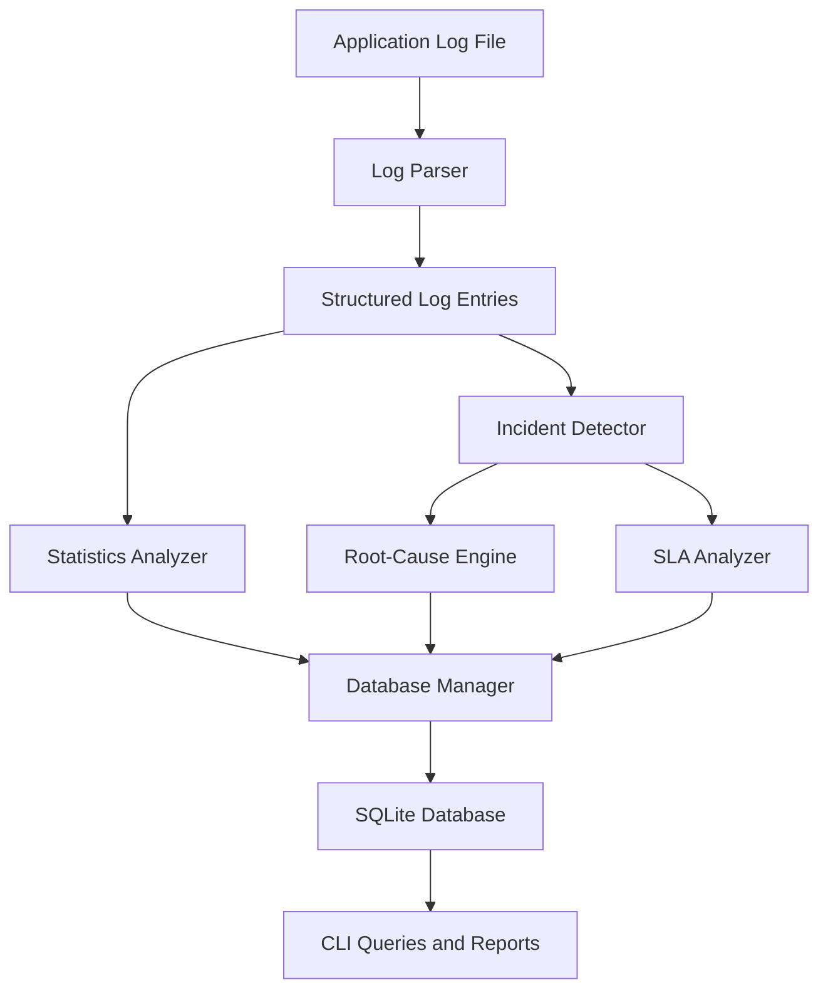

 <div align="center">

# LogLens

### C++ System Log Analyzer & Incident Management Tool

A C++17 command-line application that analyzes application logs, detects recurring failures, suggests probable root causes, and evaluates incident SLA status.


[](https://github.com/Prasad-BVB094/LogLens/actions/workflows/ci.yml)

</div>

---

## Overview

LogLens is a C++17-based system log analyzer that processes application log files and converts them into structured information for troubleshooting.

It parses log entries, calculates failure statistics, identifies recurring errors, and groups qualifying events into incidents. It also applies rule-based root-cause analysis and evaluates incident SLA status. Analysis results are stored in an SQLite database for querying and reporting.

The project applies C++ programming, STL containers and algorithms, file handling, database integration, and software testing to a practical log-analysis problem.

## Features

| Feature | Description |
|---|---|
| **Log Parsing** | Parses timestamped records into structured entries containing severity, service, and message fields. |
| **Log Filtering** | Filters records by severity, service, and date. |
| **Statistics Analysis** | Calculates severity counts, service-level statistics, and error frequencies. |
| **Incident Detection** | Detects recurring ERROR and CRITICAL events using a configurable rolling time window. |
| **Root-Cause Analysis** | Uses prioritized, configurable keyword rules to suggest probable causes. |
| **SLA Evaluation** | Evaluates incident status against severity-based response thresholds. |
| **SQLite Persistence** | Stores analysis results and incident information in a local database. |
| **Reporting** | Generates reports summarizing analyzed logs and detected incidents. |
| **Automated Testing** | Includes unit, CLI, and integration tests using GoogleTest and CTest. |

## Architecture



LogLens parses the input file and analyzes its records. The statistics analyzer calculates event counts, while the incident detector identifies recurring failures. Detected incidents can then be evaluated by the root-cause engine and SLA analyzer. Results are persisted in SQLite for subsequent queries and reporting.

## Incident Detection

LogLens identifies recurring failures using a configurable event threshold and rolling time window.

| Parameter | Default |
|---|---|
| Rolling time window | 5 minutes |
| Minimum qualifying events | 3 |
| Qualifying severities | ERROR, CRITICAL |

When the configured number of qualifying events from the same service falls within the rolling window, LogLens identifies an incident.

Detection settings are maintained in `config/detection.conf`.

## Root-Cause Analysis

The root-cause engine evaluates configured keyword rules in priority order. Matching rules provide a probable explanation for an error message.

| Example keyword | Possible explanation |
|---|---|
| `out of memory` | Memory pressure or exhausted allocation limits |
| `segmentation fault` | Invalid memory access or pointer-related error |
| `disk full` | Storage exhaustion |
| `connection timeout` | Network latency or an unreachable downstream service |
| `authentication failed` | Invalid credentials or an authentication issue |

Rules can be maintained in `config/root_cause.conf`.

These results are heuristic suggestions, not confirmed causal diagnoses. The engine uses rule matching rather than a machine-learning model.

## SLA Evaluation

LogLens evaluates incidents using severity-based time thresholds.

| Severity | Default threshold |
|---|---:|
| CRITICAL | 5 minutes |
| ERROR | 15 minutes |
| WARNING | 30 minutes |

These are application-defined defaults for SLA evaluation, not externally established service agreements.

## Technology Stack

- **Language:** C++17
- **Standard Library:** STL containers, algorithms, and utilities
- **Database:** SQLite3
- **Build System:** CMake
- **Testing:** GoogleTest and CTest
- **CI:** GitHub Actions

## Project Structure

```text
LogLens/
├── .github/
│   └── workflows/
│       └── ci.yml
├── config/
│   ├── detection.conf
│   └── root_cause.conf
├── data/
│   └── sample.log
├── include/
│   └── loglens/
│       ├── Application.h
│       ├── ArgumentParser.h
│       ├── DatabaseManager.h
│       ├── Incident.h
│       ├── IncidentDetector.h
│       ├── LogEntry.h
│       ├── LogParser.h
│       ├── ReportGenerator.h
│       ├── RootCauseEngine.h
│       ├── Severity.h
│       ├── SLAAnalyzer.h
│       ├── StatisticsAnalyzer.h
│       └── Timestamp.h
├── src/
│   ├── Application.cpp
│   ├── ArgumentParser.cpp
│   ├── DatabaseManager.cpp
│   ├── IncidentDetector.cpp
│   ├── LogParser.cpp
│   ├── ReportGenerator.cpp
│   ├── RootCauseEngine.cpp
│   ├── SLAAnalyzer.cpp
│   ├── StatisticsAnalyzer.cpp
│   ├── Timestamp.cpp
│   └── main.cpp
├── tests/
│   ├── CMakeLists.txt
│   ├── test_cli.cpp
│   ├── test_database.cpp
│   ├── test_incident_detector.cpp
│   ├── test_integration.cpp
│   ├── test_parser.cpp
│   ├── test_root_cause.cpp
│   ├── test_sla.cpp
│   └── test_statistics.cpp
├── CMakeLists.txt
└── CMakePresets.json
```

## Getting Started

### Prerequisites

- C++17-compatible compiler: GCC, Clang, or MSVC.
- CMake 3.16 or later for the standard configure-and-build commands.
- SQLite3 development libraries and headers.
- GoogleTest for the automated test suite.

CMake 3.21 or later is recommended for the included CMake presets.

On Ubuntu or Debian, install the required packages with:

```bash
sudo apt-get update
sudo apt-get install build-essential cmake libsqlite3-dev libgtest-dev
```

### Clone the Repository

```bash
git clone https://github.com/Prasad-BVB094/LogLens.git
cd LogLens
```

### Build the Application

Configure a Release build with testing enabled:

```bash
cmake -S . -B build -DCMAKE_BUILD_TYPE=Release
cmake --build build --parallel
```

GoogleTest must be available locally or obtainable through the project's configured dependency-fetching mechanism.

To build the application without the test suite:

```bash
cmake -S . -B build -DCMAKE_BUILD_TYPE=Release -DBUILD_TESTING=OFF
cmake --build build --parallel
```

## Command-Line Usage

The examples below use a Unix-like shell and assume the executable is at `build/loglens`. Adjust the executable path for your operating system and build configuration.

### Help and Version

```bash
./build/loglens --help
./build/loglens --version
```

### Analyze a Log File

```bash
./build/loglens analyze data/sample.log --db loglens.db
```

This parses the input log, performs the configured analysis, and stores results in the SQLite database.

### View Statistics

```bash
./build/loglens stats --db loglens.db
```

### Filter Log Entries

By severity:

```bash
./build/loglens filter --level ERROR --db loglens.db
```

By service:

```bash
./build/loglens filter --service DB --db loglens.db
```

By date:

```bash
./build/loglens filter --date 2026-08-25 --db loglens.db
```

### View Incidents

List detected incidents:

```bash
./build/loglens incidents --db loglens.db
```

List resolved incidents:

```bash
./build/loglens incidents --status RESOLVED --db loglens.db
```

Inspect an incident:

```bash
./build/loglens incident <INCIDENT_ID> --db loglens.db
```

Replace `<INCIDENT_ID>` with an ID returned by the `incidents` command. Incident IDs are generated dynamically.

### Generate a Report

```bash
./build/loglens report --db loglens.db
```

### Inspect Database Information

```bash
./build/loglens db-info --db loglens.db
```

### Override Configuration Files

```bash
./build/loglens analyze data/sample.log \
  --config-detection config/detection.conf \
  --config-rca config/root_cause.conf \
  --db loglens.db
```

## Testing

The project includes **48 automated tests** covering:

- Log parsing and timestamp validation
- Statistics and filtering
- Incident detection and recovery matching
- Root-cause rule matching and priority handling
- SLA threshold evaluation
- SQLite initialization, queries, and transactions
- CLI behavior and end-to-end workflows
- Integration pipeline behavior and a 100,000-record benchmark

The Windows Release test suite passed all 48 tests using CTest.

Run the test suite locally after configuring and building with testing enabled:

```bash
ctest --test-dir build --output-on-failure
```

The result above verifies the reported Windows Release run; it should not be interpreted as confirmation that every operating system and build configuration has passed.

## Current Limitations

- LogLens analyzes existing log files in batches; it does not monitor live processes or real-time log streams.
- Root-cause analysis relies on configured keyword rules and cannot confirm the actual cause of a failure.
- Incident detection depends on configured severity levels, event thresholds, and time windows.
- SLA results depend on application-defined thresholds and available event timestamps.
- The parser expects records in the following format:

  ```text
  YYYY-MM-DD HH:MM:SS LEVEL SERVICE MESSAGE
  ```

## Future Improvements

- Support additional log formats.
- Expand configurable incident-detection rules.
- Improve edge-case handling for out-of-order timestamps and recovery events.
- Add further tests for malformed input and boundary conditions.

---

<div align="center">

**LogLens — Turning application logs into actionable diagnostic information.**

</div>
